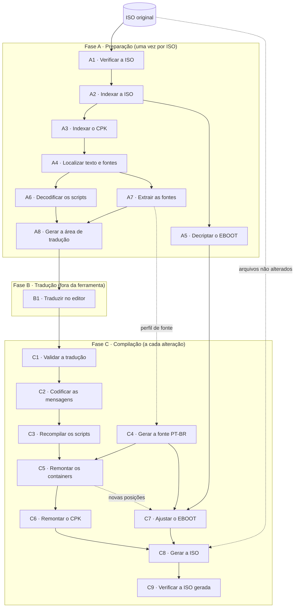
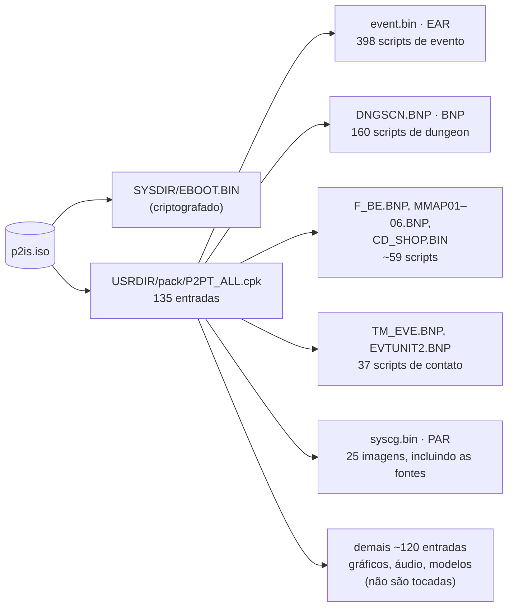

# Mapa do processo — Persona 2 Innocent Sin (PSP) · v3

Guia das etapas da v3 para extrair o texto do jogo, traduzi-lo e reconstruir a ISO.
A ferramenta nasceu como P2Tool e hoje se chama **Game Translation Engine**: as fases A
e C deste mapa formam o motor `p2is-psp-us`; a fase B (tradução) e os motores valem
para qualquer jogo. A documentação de uso está no [README](README.md).
O fluxo é próprio: as versões anteriores ([v1](https://github.com/eiowlta/p2_tool) e [v2](https://github.com/dfs-Patrick/persona2_translation_tool/tree/1.0))
servem de referência sobre os formatos do jogo, mas não ditam a ordem nem a forma
das etapas.

Cada etapa é descrita por:
- **Resultado**: o que a etapa entrega.
- **Método**: quais operações são feitas sobre a entrada X para chegar ao resultado Y.
- **Necessidade**: por que a etapa existe e quando precisa ser executada.

Escopo inicial: Innocent Sin, versão US (`ULUS-10584`), tradução PT-BR.

---

## Princípios do fluxo

1. **A ISO original não é extraída por inteiro.** Ela é lida diretamente, sob demanda,
   e só o necessário para a tradução vai para o disco: texto e fontes.
2. **Cada etapa grava o próprio resultado em cache**, junto com o hash da entrada.
   Se a entrada não mudou, a etapa é pulada. Uma compilação depois de editar um único
   arquivo refaz apenas o caminho desse arquivo até a ISO.
3. **O trabalho do tradutor nunca é sobrescrito.** Gerar a área de tradução de novo
   preserva o que já foi traduzido.
4. **Toda etapa de reconstrução tem uma etapa inversa de leitura.** Se um container
   remontado não for lido de volta igual ao esperado, a compilação para ali.

---

## Visão geral

### Onde está o que precisamos dentro da ISO

---

## Fase A · Preparação

Executada uma vez para cada ISO de origem. O resultado fica em cache e só é refeito
se a ISO mudar ou se a ferramenta mudar a forma de ler algum formato.

### A1 · Verificar a ISO

- **Resultado:** a identificação da ISO de origem: ID do jogo, região, tamanho e hash.
  Se a ISO não for a esperada, o processo para com uma mensagem clara.
- **Método:** ler o descritor de volume (setor 16) e os arquivos `UMD_DATA.BIN` e
  `PARAM.SFO` para obter o ID do jogo. Calcular o hash do arquivo inteiro e comparar
  com uma lista de ISOs conhecidas.
- **Necessidade:** sempre, no início de qualquer comando. Todas as tabelas da
  ferramenta (posições no EBOOT, nomes no CPK) são específicas da versão US. Uma ISO
  EU, JP ou já modificada geraria resultados errados sem aviso. O hash também serve
  de chave para o cache.

### A2 · Indexar a ISO

- **Resultado:** um catálogo com caminho, setor inicial (LBA) e tamanho de cada
  arquivo da ISO, gravado em cache.
- **Método:** a partir do descritor de volume, percorrer recursivamente as entradas
  de diretório ISO 9660 (setores de 2048 bytes), sem copiar nenhum arquivo.
- **Necessidade:** é a base de todo acesso aos dados. Com o catálogo, qualquer
  arquivo é lido direto da ISO original pela posição. Ele também guarda o layout
  original, que C8 usa para manter os arquivos não alterados no mesmo lugar.

### A3 · Indexar o CPK

- **Resultado:** a tabela das 135 entradas de `P2PT_ALL.cpk`: ID, nome, posição,
  tamanho e se está comprimida.
- **Método:** localizar o CPK pelo catálogo de A2, ler o cabeçalho e as tabelas
  internas (`@UTF`: TOC e ITOC) e associar cada ID ao nome e ao tipo conhecidos.
- **Necessidade:** quase todo o conteúdo do jogo está dentro desse CPK. Indexá-lo
  permite abrir só as entradas que interessam, em vez de copiar um arquivo de quase
  1 GB. É refeita junto com A2.

### A4 · Localizar texto e fontes

- **Resultado:** a lista dos arquivos que a tradução usa (~620 scripts de evento e
  dungeon, 37 scripts de contato, a demo e as imagens de fonte), cada um com seu
  caminho completo: ISO → CPK → container → arquivo.
- **Método:** abrir em memória apenas os containers que têm texto ou fonte (EAR,
  BNP, PAR), separar as entradas internas, descomprimir as que usam LZSS ou RLE e
  identificar o tipo de cada uma.
- **Necessidade:** é o que delimita o escopo. Sem esta etapa, seria preciso abrir os
  ~26.500 arquivos do jogo, quando a tradução usa cerca de 660. Também registra como
  cada container foi montado (alinhamento, compressão, ordem), informação de que C5
  precisa para remontá-lo.

### A5 · Decriptar o EBOOT

- **Resultado:** o executável do jogo decriptado (ELF), em memória (~26 ms; não
  precisa de cache).
- **Método:** ler `EBOOT.BIN`, reconhecer o cabeçalho `~PSP` (tag `0xD91613F0`, tipo 2)
  e decriptar com KIRK: o cabeçalho com a chave `0x5D` e conferência SHA-1, e o corpo
  com AES-CBC (comando KIRK 1). Só duas chaves são necessárias. O resultado é
  conferido pelo tamanho do ELF gravado no cabeçalho. O `BOOT.BIN` desta ISO está
  zerado, então não serve de atalho.
- **Necessidade:** o EBOOT guarda a tabela de caracteres da fonte, a largura de cada
  letra e as posições fixas de alguns arquivos internos. Para trocar a fonte (C7) ou
  quando um container muda de tamanho, é preciso alterá-lo, e isso só é possível com
  ele decriptado.

### A6 · Decodificar os scripts

- **Resultado:** para cada script, a lista das suas mensagens em texto legível, com
  os comandos de controle (cor, pausa, nome do personagem, escolhas) em uma notação
  própria. O código do script fica separado das mensagens.
- **Método:** interpretar o binário de cada script (EFB, CFB, PDEMO), separar as
  instruções do bloco de mensagens e converter os bytes em caracteres com a tabela de
  codificação original do jogo (terminador de mensagem `0x1103`).
- **Necessidade:** é o que transforma bytes em texto traduzível. A separação entre
  código e mensagens garante que o tradutor só mexa no texto e não quebre a lógica
  do jogo.

### A7 · Extrair as fontes

- **Resultado:** as páginas de fonte do jogo como PNG e a tabela que liga cada
  caractere à sua posição na imagem.
- **Método:** ler as imagens GIM de `syscg.bin` (arquivos 7 e 8 = fonte normal, 12 e
  13 = fonte estreita; 256×256, 4 bits por pixel em blocos "swizzled", paleta branca
  com 16 níveis de transparência) e convertê-las para PNG. Na interface, "Exportar
  fontes…" grava `fonts/original/` e uma cópia editável do perfil PT-BR em
  `fonts/pt-br/`.
- **Necessidade:** o jogo não tem acentos. Para criar ou ajustar o perfil PT-BR, é
  preciso partir das páginas originais. Só é necessária na primeira preparação ou ao
  criar um novo perfil de fonte.

### A8 · Gerar a área de tradução

- **Resultado:** os arquivos TBF, um por script, com texto original e tradução lado a
  lado, prontos para o editor.
- **Método:** gravar cada mensagem de A6 como uma entrada TBF (chave, texto original,
  comandos finais, campo de tradução). Os arquivos são identificados pela origem
  (`originalDirectory` + `originalFilename`), não pelo nome. Se já existe um TBF para
  aquela origem, gerado antes ou importado da v2, ele não é alterado: só são criados os
  que faltam, e o relatório aponta os arquivos cujas mensagens não batem com a ISO.
- **Necessidade:** é a interface com o tradutor. Precisa ser compatível com os TBF que
  já existem da v2, para não perder o trabalho feito. Executada na primeira preparação
  e sempre que a ferramenta passar a extrair textos novos.

---

## Fase B · Tradução

### B1 · Traduzir no editor

- **Resultado:** os TBF com o campo de tradução preenchido.
- **Método:** edição no editor de TBF da própria ferramenta, que substitui a extensão
  do VS Code da v2. TBF feitos na v2 são importados sem conversão.
- **Necessidade:** é o trabalho humano do projeto. A ferramenta só precisa garantir
  que o formato seja estável e que as etapas seguintes informem os erros com clareza.

### B2 · Glossário

- **Resultado:** `translation/glossary.json` no projeto, com os termos de referência
  (inglês, português, descrição, se diferencia maiúsculas) e uma página para editá-los.
- **Método:** no editor, cada termo é procurado como palavra inteira (o mais longo
  primeiro): o inglês no texto original e o português na tradução. O termo encontrado
  ganha outra cor; ao passar o mouse aparece "inglês → português" e a descrição. Se o
  original tem o termo e a tradução não tem o equivalente, a mensagem avisa.
- **Necessidade:** nomes, golpes, lugares e expressões recorrentes precisam sair iguais
  em toda a tradução, feita por várias pessoas. O arquivo fica dentro de `translation/`
  para ir junto com os TBF no repositório da equipe.

### B3 · Correção ortográfica

- **Resultado:** palavras desconhecidas da tradução sublinhadas em vermelho, com
  sugestões no clique direito.
- **Método:** Hunspell (WeCantSpell.Hunspell, .NET puro) com o dicionário pt_BR do
  LibreOffice (VERO 3.2, LGPLv3/MPL, em `data/dictionaries/pt-br`). Comandos do jogo
  e termos do glossário não são verificados. "Adicionar ao dicionário" grava a palavra
  em `translation/dictionary.txt` (uma por linha), que vale para o projeto todo.
- **Necessidade:** a tradução da v1 trouxe erros como "voce", "horrivel", "adimirado";
  o corretor os aponta enquanto se escreve, sem mudar nada sozinho.

### B4 · Realce

- **Resultado:** no original e na tradução, os comandos do jogo (`[color(...)]`,
  `[delay(30)]`…) em cor própria, comandos desconhecidos em vermelho, e os termos do
  glossário destacados.
- **Método:** as caixas de texto do editor passam a ser do AvaloniaEdit, com um
  colorizador para comandos e glossário e uma camada que desenha o sublinhado da
  ortografia. Os nomes de comando vêm do motor do jogo.
- **Necessidade:** separar à vista o que é texto (traduzível) do que é código (que deve
  ser mantido), e mostrar o glossário no ponto em que ele é útil.

### B5 · Busca global

- **Resultado:** aba "Busca" que procura um texto em todos os TBF do projeto, no original
  (antes), na tradução (depois) ou nos dois, com ou sem diferenciar maiúsculas.
- **Método:** os TBF são lidos em paralelo a cada busca (~50 ms para 617 arquivos e
  13 mil mensagens), sem índice. Um espaço na busca casa com qualquer espaço ou quebra de
  linha, porque o texto do jogo é quebrado à mão ("Masked Circle" está partido em 46
  mensagens). Clicar num resultado abre o arquivo na mensagem, e o termo fica destacado
  nas caixas do editor. Alterações ainda não salvas são gravadas antes de buscar.
- **Necessidade:** achar onde um nome ou frase aparece no jogo inteiro, para manter a
  tradução coerente e corrigir em lote.

---

## Motores

Um **motor** reúne tudo o que é próprio de um jogo: como reconhecer a ISO, onde está o
texto, como compilar a tradução de volta, os comandos das mensagens e as fontes. O
restante (projeto, editor, glossário, ortografia, interface) é comum a todos.

- **Resultado:** a interface `IGameEngine` e um registro de motores. O motor
  `p2is-psp-us` (Persona 2: Innocent Sin, PSP, US) é o único por enquanto e contém as
  etapas A e C deste mapa.
- **Método:** o projeto grava o motor escolhido em `translation-project.json` (`"engine"`); projetos
  sem o campo usam `p2is-psp-us`. Ao criar um projeto, a tela inicial lista os motores e
  a ISO é conferida pelo motor escolhido. O projeto pede ao motor para gerar os TBF,
  validar, compilar, descrever os arquivos e exportar as fontes.
- **Necessidade:** permitir motores de outros jogos (ex.: Eternal Punishment) na mesma
  interface, sem tocar no editor nem no formato do projeto.

---

## Fase C · Compilação

Executada a cada vez que se quer testar a tradução. Com o cache, só refaz o caminho
dos arquivos alterados.

### C1 · Validar a tradução

- **Resultado:** um relatório com arquivo, mensagem e motivo de cada problema:
  caractere sem glifo na fonte, comando de controle inválido ou desbalanceado, chave
  de mensagem inexistente. Se houver erro, a compilação para.
- **Método:** ler os TBF, interpretar os comandos de controle e conferir cada
  caractere com a tabela do perfil de fonte escolhido. O TBF é lido como a v2
  compilava: remontado em texto `.msg` e separado no `[end]`. Isso junta de volta as
  mensagens que a divisão da v2 cortou em linhas terminadas em ":" (ex.: `> Notice:`).
  Avisos, que não param a compilação: TBF de script `.ef` com tradução, chave
  inexistente, dois TBF para o mesmo script. Na interface: botão "Validar".
- **Necessidade:** antes de toda compilação. Achar o erro aqui custa segundos; achá-lo
  dentro do emulador custa minutos e é difícil de localizar.

### C2 · Codificar as mensagens

- **Resultado:** os bytes de cada mensagem, já na codificação do jogo.
- **Método:** uma mensagem cujo texto não mudou mantém os bytes originais. As
  traduzidas são convertidas com a tabela de caracteres do perfil PT-BR, e os comandos
  de controle viram os opcodes correspondentes. Um `[item_with_type(item_0)]` vindo da
  v2 é trocado pelo item da mensagem original.
- **Necessidade:** o jogo só entende a própria codificação. Precisa ser feita para
  cada script com mensagens alteradas.

### C3 · Recompilar os scripts

- **Resultado:** os binários EFB, CFB e PDEMO atualizados.
- **Método:** o código do script não é recompilado. Tudo antes da seção de mensagens
  fica como está; a seção é regravada com as mensagens de C2, na mesma ordem, e o
  argumento de cada `msgShow` (opcode `0x13`) recebe a nova posição da sua mensagem.
  Bytes da seção que não pertencem a nenhuma mensagem são mantidos. A demo de personas
  (`P_DEMO.BNP`) tem uma mensagem por entrada e só troca as entradas alteradas.
- **Necessidade:** a mensagem traduzida quase nunca tem o mesmo tamanho da original,
  então as referências do script precisam ser refeitas. Só para os scripts alterados.

### C4 · Gerar a fonte PT-BR

- **Resultado:** as páginas de fonte com os glifos acentuados no formato GIM, a tabela
  de caracteres do perfil e a largura de cada glifo.
- **Método:** o perfil PT-BR testado na v2 vem embutido na ferramenta
  (`data/is/fonts/pt-br`). Ele tem:
  - a tabela de caracteres (30 códigos de kanji não usados viram letras acentuadas;
    mais 5 viram `"`, `_` e `°`, que a fonte já desenhava sem código, e `º`/`ª`,
    desenhados para o PT-BR nas células de `ヽ`/`ヾ`, que nenhuma mensagem usa);
  - o mapa da fonte e as quatro páginas;
  - receitas que compõem glifos (topo de um acento + base de uma letra).

  A página gravada é a **original do jogo**; do perfil entram só as células dos
  caracteres que ele acrescenta, já movidas de volta pelo deslocamento da página do
  perfil (detectado comparando os glifos em comum). As páginas herdadas da v2 têm todos
  os glifos deslocados (fonte normal 1 px para cima, estreita 3 px para a direita). Como
  o jogo recorta cada glifo pela tabela de larguras original, isso cortava a borda
  esquerda das maiúsculas da fonte estreita: o banner de local mostrava "{even" em vez
  de "Seven". Nem a v1 nem a v2 resolviam isso.

  Cada página é gravada no GIM original com a paleta do jogo (cor mais próxima). Assim
  `syscg.bin` mantém o tamanho exato, que o EBOOT também guarda (instruções `lui`/`ori`
  em `0x088686F0`). A largura de cada glifo novo é medida na página já convertida. O
  projeto escolhe o perfil no campo `font` do `translation-project.json`: `pt-br`, `original`
  ou uma pasta.
- **Necessidade:** sem ela, os acentos não aparecem. Só refeita quando o perfil de
  fonte muda.

### C5 · Remontar os containers

- **Resultado:** os containers EAR, BNP e PAR que tiveram algum arquivo alterado,
  junto com a nova tabela de posições de cada um.
- **Método:** inserir os arquivos novos de C3/C4 no lugar dos originais, respeitando a
  ordem, o alinhamento e a compressão do original. Só o caminho de um script alterado
  é remontado; os demais arquivos são copiados como estavam. As regras abaixo
  reproduzem o original byte a byte quando nada muda:
  - EAR (`event.bin`): cada arquivo começa em setor novo, e o par (início, fim) grava
    o fim já alinhado. Os filhos são gzip; o cabeçalho gzip original (nome e data) é
    mantido.
  - PAR: arquivos alinhados a 16 bytes, com `PSPCHECK` no fim.
  - BNP: entradas alinhadas a 4 bytes. A que começava um setor no original continua
    começando um setor (todas no `MMAP*` e no `F_BE`). Cada entrada mantém tipo, tag e
    compressão (LZSS no `DNGSCN`, RLE no `F_BE`), com compressores próprios.
- **Necessidade:** os scripts e as fontes ficam dentro desses containers. Como os
  tamanhos mudam, as posições internas mudam junto. Só para os containers alterados.

### C6 · Remontar o CPK

- **Resultado:** o novo `P2PT_ALL.cpk`.
- **Método:** copiar o CPK original região por região. Uma entrada alterada que cabe no
  espaço antigo fica no lugar; se cresce, as seguintes andam setores inteiros. Nas
  tabelas `@UTF` só mudam números, no próprio lugar: posição e tamanhos no TOC, e
  `ContentSize`/`EtocOffset` no cabeçalho. As entradas alteradas são gravadas sem
  compressão; o CPK aceita as duas formas, entrada por entrada.
- **Necessidade:** os containers do jogo só são carregados de dentro do CPK. Refeita
  sempre que algum container mudou.

### C7 · Ajustar o EBOOT

- **Resultado:** o EBOOT final.
- **Método:** sobre o EBOOT decriptado de A5. Toda tabela é conferida contra o
  original antes de ser regravada (`data/is/eboot_tables.json`):
  1. a tabela evento→fonte e as larguras dos glifos novos (C4), localizadas pelo
     conteúdo;
  2. as posições dos arquivos dentro dos containers:
     - `event.bin` em `0x08BBC910`: pares início/fim, idênticos ao cabeçalho do EAR;
     - `DNGSCN.BNP` e `MMAP01–06.BNP`: posição no setor, setor e tamanho (no MMAP, o
       tamanho é sem o cabeçalho de 8 bytes);
  3. o local do CPK no disco. O jogo abre `P2PT_ALL.cpk` por setor
     (`disc0:/sce_lbn0x448d0_size0xf29a4b0`), então o setor e o tamanho são
     reescritos. O texto novo tem de caber no espaço do original, o que permite ao CPK
     crescer até 0xFFFFFFF bytes (~14 MB a mais que hoje).

  O EBOOT vai para a ISO decriptado, como na v2; o PPSSPP e os firmwares customizados
  aceitam.
- **Necessidade:** a fonte e algumas posições de arquivos estão fixas no executável.
  Sem esse ajuste, os acentos não aparecem e o jogo pode ler um arquivo na posição
  errada. Refeito quando a fonte ou o tamanho de um container muda.

### C8 · Gerar a ISO

- **Resultado:** a ISO traduzida.
- **Método:** copiar a ISO original e substituir só o CPK e o EBOOT. Um arquivo que
  cabe antes do próximo setor ocupado fica no lugar; senão vai para o fim do volume. O
  CPK tem só 11 setores de folga antes dos vídeos, então quase sempre vai para o fim.
  O espaço antigo é zerado. Os registros de diretório (setor e tamanho) e o tamanho do
  volume são corrigidos no próprio lugar, então as tabelas de diretório e os
  identificadores do volume ficam idênticos aos originais. A gravação é feita em um
  arquivo temporário, que só substitui o destino no final.
- **Necessidade:** é a entrega final, usada no emulador ou no console. Sempre a
  última etapa da compilação.

### C9 · Verificar a ISO gerada

- **Resultado:** a confirmação de que a ISO está íntegra, ou um relatório do que
  diverge.
- **Método:** reler a ISO gerada com o próprio leitor das etapas A2–A6 e conferir:
  - os bytes de todas as mensagens dos 617 scripts;
  - o conteúdo de cada entrada remontada do CPK;
  - as tabelas do EBOOT contra os containers gerados e o local do CPK gravado no EBOOT;
  - com perfil de fonte, as páginas e a tabela de caracteres.

  Qualquer diferença vira erro no relatório. Falta abrir no PPSSPP (manual).
- **Necessidade:** fecha o ciclo. Problemas de layout ou de container aparecem aqui,
  e não no meio do jogo.

---

## Aprendizado das versões anteriores

| Tema | O que a v1/v2 ensina | Decisão da v3 |
|---|---|---|
| Acesso à ISO | A v2 extrai a ISO inteira para o disco e, a cada compilação, extrai de novo e apaga. | Ler direto da ISO (A2) e manter cache. |
| Escopo | A v2 extrai ~26.500 arquivos para usar ~660. | Abrir apenas os containers com texto e fonte (A4). |
| Paralelismo | A extração da v2 é sequencial, e cada leitura passa por um mutex. | Processar os containers em paralelo. |
| Saber o que mudou | A v2 compara datas de arquivo. | Comparar hashes. |
| TBF | Formato já usado pelos tradutores. | Manter compatível e nunca sobrescrever um TBF existente (A8). |
| Formatos | A v1/v2 já decifrou ISO, CPK, BNP (LZSS/RLE), EAR, PAR, EFB, CFB, GIM e KIRK. | Usar como referência de formato ao implementar cada etapa. |
| TBF de scripts (`.ef`) | A v2 gera um TBF `.ef` por script, mas o texto dele fica em comentários que a compilação ignora: editá-lo não muda o jogo. | Gerar só os TBF de mensagens (`.msg`). Os `.ef` importados da v2 aparecem marcados como "(v2)". |
| Item recebido (`[item_with_type]`) | A v2 lê a palavra errada do comando e escreve sempre `item_0`. Ao recompilar, todos esses diálogos mostrariam o item 0. Afeta 22 arquivos. | Ler o item verdadeiro. Em C2, um `item_0` vindo de uma tradução da v2 deve ser trocado pelo item da mensagem original. |
| Cores curtas (opcode `0x1D`) | A v2 as lê como `[color(...)]`, mas ao recompilar usa o formato longo, o que gera um valor inválido (`0xFFF1`) para `white_1`, `default` etc. | O texto continua igual; a codificação escolhe o formato certo pelo valor da cor. |
| Scripts de contato (`cscript`) | A v2 não tinha conversor para eles: os 37 scripts de contato nunca foram exportados. | Ficam para uma etapa futura. Hoje o escopo são os 617 arquivos que a v2 também cobria. |
| Dois códigos para espaço | A tabela tem `0x005F` e `0x1120` para " ". Uma mensagem (`m006e`, `msg_117`) usa o primeiro. | Em C2, mensagens não traduzidas são copiadas com os bytes originais, então nada muda. |
| Tabelas de posição no EBOOT | Confirmado com uma ISO gerada pela v2: as tabelas de `event.bin`, `DNGSCN.BNP` e `MMAP01.BNP` no EBOOT continuam com as posições originais, mas os containers que ela grava mudam de layout. A compilação de tradução da v2 nunca chama `applyTOC`, e o `applyTOC` grava 6 bytes por entrada de BNP, quando a tabela usa 8. | C7 regrava as três tabelas depois de conferir o original. C9 confere de novo na ISO gerada. |
| Cabeçalho do EAR | `ear.build` grava os pares em `i*4` e `(i+1)*4` em vez de `i*8` e `i*8+4`, sobrepondo um par ao seguinte, e grava o fim sem o alinhamento que o original usa. | Pares em `i*8`; fim alinhado ao setor, igual ao original e à tabela do EBOOT. |
| Alinhamento dos BNP | A v2 decide o alinhamento por um parâmetro `group`. Para os `MMAP*.BNP` (sem `group`), junta as entradas a cada 4 bytes, mas no original cada entrada começa um setor. | O alinhamento de cada entrada é lido do próprio original. |
| Chaves falsas nos TBF | A divisão da v2 trata uma linha de diálogo terminada em ":" como chave de mensagem. A compilação da v2 lê até o `[end]` e junta tudo de volta, mas, quando a linha é a primeira da mensagem, acrescenta uma quebra de linha no início (4 mensagens). | C1/C2 leem o TBF do mesmo jeito que a v2 compilava, sem a quebra extra. Os TBF continuam idênticos aos da v2. |
| Carregamento do CPK | O jogo abre o CPK por setor (`sce_lbn`). A v2 troca isso por carregamento por nome (`patchFileLoading`). | A v3 mantém o mecanismo original e reescreve setor e tamanho; o carregamento por nome fica como alternativa se o CPK passar de 0xFFFFFFF bytes. |
| CRC das tabelas do CPK | O cabeçalho tem `TocCrc`/`ItocCrc`/`GtocCrc`, que não é um CRC-32 comum. A v2 gera um CPK novo sem essas colunas. | C6 só altera números no TOC e mantém os CRC originais, como fazem as ferramentas de mod de CPK. Confirmar no emulador. |

---

## Andamento

| Marco | Etapas | Situação |
|---|---|---|
| 1 | A1, A2, A3 · projeto · editor de TBF | ✅ Testado com a ISO real: 135 entradas do CPK lidas e descomprimidas em ~1 s. O TBF gravado é idêntico ao formato da v2. |
| 2 | A4, A6, A8 · gerar os TBF a partir da ISO | ✅ 617 TBF, 13.440 mensagens. Comparados com a extração da v2 sobre a mesma ISO: 595 idênticos byte a byte e 22 diferentes só pela correção do `item_with_type`. Todas as mensagens voltam aos bytes originais quando recodificadas. |
| 3 | A5, A7 · C1–C9 · compilar a ISO traduzida | 🟨 Compila e confere a ISO (C9 sem erros), com fonte PT-BR e textos de todos os tipos de script. Na interface: "Validar", "Compilar ISO…" e "Exportar fontes…". Falta testar no PPSSPP. |
| 4 | B2, B3, B4 · motores | ✅ Glossário (página + destaque + dica de termo faltando), ortografia pt-BR (sugestões e dicionário do projeto), realce de comandos e motor `p2is-psp-us` escolhido na criação do projeto. Testado na interface com o projeto do lab. |

A5 (EBOOT) e A7 (fontes) passaram para o Marco 3, junto das etapas de compilação que
dependem delas (C4 e C7).

Código: `src/GameTranslationEngine.Core` (formatos e etapas), `src/GameTranslationEngine.App` (interface
Avalonia), `tests/GameTranslationEngine.Tests` (os testes que usam a ISO leem `lab/p2is.iso` e
são pulados se ela não existir). `data/is/` guarda o que a ferramenta sabe do jogo
(tabela de caracteres, nomes de bits, o catálogo de fontes de texto gerado por
`scripts/gen_text_sources.py`, as tabelas do EBOOT em `eboot_tables.json` e o perfil
de fonte PT-BR em `fonts/pt-br`).

### Medições (mesma máquina, mesma ISO)

| Etapa | v2 | v3 |
|---|---|---|
| Extração completa até os TBF | 52,9 s (33.331 arquivos, 2,1 GB em disco) | 0,73 s (617 TBF; nada além disso vai para o disco) |
| Criar projeto (verificação + hash SHA-256 + extração), pela interface | — | ~3 s |
| Compilação da mesma tradução (41 mensagens em 7 scripts, um deles bem mais longo), com fonte PT-BR, até a ISO | 30,6 s (com as falhas de tabela acima) | 3,5 s, incluindo a conferência C9 |

---

## Pontos em aberto

- Textos dentro do próprio EBOOT (menus, itens, nomes de personas): entram no escopo?
  Se sim, precisam de etapas próprias em A e C.
- Imagens com texto (menus e títulos em GIM): entram no escopo da primeira versão?
- Variante EU e Eternal Punishment: fora do escopo inicial.
- Scripts de contato (`TM_EVE.BNP`, `EVTUNIT2.BNP`, 37 arquivos): têm texto, mas a v2
  nunca os exportou. O fluxo básico já compila; falta o conversor desses scripts.
- Testar a ISO gerada no PPSSPP: abertura, um evento traduzido depois de `e0000`
  (posições deslocadas), dungeon, mapa, acentos. É o que confirma C6 (CRC do CPK) e as
  tabelas de C7.
- Cache por etapa (princípio 2): com a compilação inteira em ~4 s, ainda não fez falta.
- Realce: os argumentos dos comandos não são conferidos no editor (ex.: `[color(xyz)]`
  aparece como comando válido); quem confere é o "Validar".
- Glossário: os caracteres que a fonte não tem (`º`, `ª`…) poderiam ser apontados no
  próprio editor, como a ortografia.
